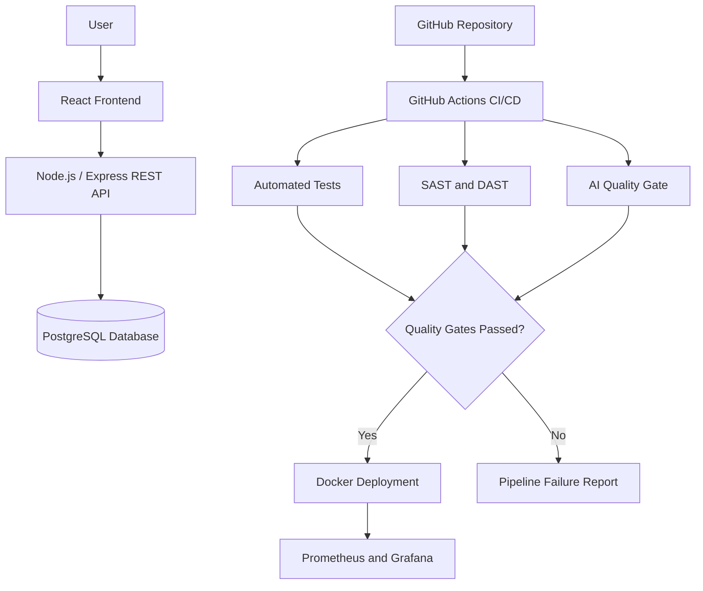

# 💰 FinTrack — Personal Expense Management System


## 📖 About the Project

**FinTrack** is a web-based personal finance management application designed to help users organize, monitor, and analyze their financial activities.

The platform aims to provide an intuitive and responsive interface for tracking income, expenses, budgets, and financial trends.

Beyond its financial management capabilities, FinTrack serves as a practical implementation of modern **DevOps, DevSecOps, AIOps, and AI for Software Engineering (AI4SE)** principles.

The project focuses on developing an intelligent **Continuous Integration and Continuous Deployment (CI/CD) pipeline**, integrating automated testing, security analysis, AI-assisted quality gates, and application monitoring.

### 🎯 Main Objectives

- Develop a functional and responsive personal finance application.
- Implement secure user authentication and financial data management.
- Automate software building, testing, and deployment.
- Integrate static and dynamic application security testing.
- Incorporate AI-assisted code analysis and quality validation.
- Monitor application performance and reliability.
- Apply Agile development practices using Scrum.
- Evaluate the effectiveness and reproducibility of AI-based quality gates.

---

## ✨ Planned Features

### 🔐 User Authentication
- User registration and login.
- JWT-based authentication.
- Secure password hashing.
- Protected API endpoints.
- User-specific financial information.

### 💳 Income and Expense Management
- Add income and expense transactions.
- Edit and delete existing transactions.
- Categorize financial movements.
- Filter transactions by date, type, and category.
- View transaction history.

### 📊 Financial Dashboard
- Overview of total income and expenses.
- Current financial balance.
- Monthly financial summaries.
- Interactive charts and statistics.
- Expense distribution by category.

### 🎯 Budget Management
- Define monthly spending limits.
- Create category-based budgets.
- Track budget consumption.
- Receive notifications when spending limits are exceeded.

### 🤖 Intelligent Features (Optional)
- Detection of unusual spending patterns.
- AI-assisted financial insights.
- Personalized spending analysis.

**Note:** AI-powered financial features are optional extensions. The primary AI requirement of this project is the integration of AI-enhanced quality gates into the CI/CD pipeline.

---

## 🏗️ System Architecture

FinTrack follows a planned **modular monolithic architecture**, separating the frontend, backend, and database into clearly defined components.

The architecture prioritizes maintainability, testability, security, and ease of deployment.

### Architecture Overview



### Architectural Principles

- **Modularity:** separation of application responsibilities.
- **Security:** authentication, authorization, and automated vulnerability analysis.
- **Maintainability:** organized codebase and automated testing.
- **Reproducibility:** version-controlled configurations and containerized environments.
- **Observability:** application metrics, dashboards, and alerts.

---

## 🛠️ Technology Stack

The following technologies are planned for development.

| Component | Technology |
|---|---|
| Frontend | React, Vite, JavaScript, CSS |
| Backend | Node.js, Express.js |
| Database | PostgreSQL |
| Authentication | JWT, bcrypt |
| API Architecture | REST |
| Testing | Vitest, Supertest |
| CI/CD | GitHub Actions |
| Containerization | Docker, Docker Compose |
| Static Security Testing | Semgrep |
| Dynamic Security Testing | OWASP ZAP |
| AI Quality Gates | LLM API Integration |
| Monitoring | Prometheus, Grafana |
| Version Control | Git, GitHub |
| Project Management | Jira |

---

## 📁 Project Structure

The repository is organized into the following directories:

```text
gestor-despesas-pessoais/
│
├── frontend/
│   └── React application
│
├── backend/
│   └── Node.js and Express REST API
│
├── database/
│   └── PostgreSQL scripts and migrations
│
├── tests/
│   └── Integration and end-to-end tests
│
├── docker/
│   └── Docker configurations
│
├── docs/
│   └── Architecture and project documentation
│
├── scripts/
│   └── Development and automation scripts
│
├── .github/
│   └── workflows/
│       └── CI/CD pipeline configurations
│
├── README.md
├── .gitignore
├── .env.example
└── docker-compose.yml
```

**Note:** This structure represents the intended organization and will be populated progressively during development.

---

## 🔄 Intelligent CI/CD Pipeline

A central objective of FinTrack is to implement an automated software delivery pipeline.

The pipeline will be triggered by relevant GitHub events, including pushes and pull requests.

### Planned Pipeline Stages

**1. Source Code Checkout**

Retrieve the latest version of the application from the GitHub repository.

**2. Build and Dependency Installation**

Install dependencies and verify that the application can be successfully built.

**3. Automated Testing**

Execute unit and integration tests to validate application functionality.

**4. Static Application Security Testing (SAST)**

Analyze source code to identify potential security vulnerabilities and insecure coding patterns.

**5. AI-Enhanced Quality Gate**

Use an AI-based tool to review code changes, analyze test results, and identify potential quality issues.

**6. Dynamic Application Security Testing (DAST)**

Execute security scans against a running instance of the application.

**7. Deployment**

Deploy approved application versions using containerized environments.

**8. Monitoring and Observability**

Collect operational metrics and provide dashboards and alerts.

Failed mandatory quality gates will prevent the deployment process from proceeding.

---

## 🧠 AI-Augmented Software Quality

The project aims to investigate the role of Artificial Intelligence in modern software engineering workflows.

### AI-Assisted Code Review

An AI-based tool will analyze code changes and identify potential issues, including:

- Code smells.
- Maintainability concerns.
- Missing input validation.
- Potential security weaknesses.
- Opportunities for refactoring.

### Reproducible AI Quality Gates

To evaluate the reliability of AI-assisted decisions, the project will implement reproducibility checks.

These checks will include:

- Version-controlled prompt templates.
- Documented AI model versions.
- Defined model parameters and decision thresholds.
- Repeated execution under equivalent configurations.
- Comparison and documentation of AI-generated decisions.
- Analysis and mitigation of inconsistent results.

AI-generated feedback will complement deterministic testing and security tools rather than replace them.

---

## 🔒 Security and DevSecOps

Security will be integrated throughout the software development lifecycle.

Planned security practices include:

- Secure password storage.
- JWT-based authentication.
- Authorization and protected endpoints.
- Input validation.
- Environment variable management.
- Dependency vulnerability scanning.
- Static security analysis using Semgrep.
- Dynamic security analysis using OWASP ZAP.
- Automated security gates within GitHub Actions.

---

## 📈 Monitoring and Observability

FinTrack will include an observability layer to monitor application behavior and identify potential problems.

### Planned Metrics

- HTTP request duration.
- API response times.
- Application error rates.
- Service availability.
- Resource utilization.
- Database-related performance indicators.

### Monitoring Tools

**Prometheus** will be used to collect application metrics.

**Grafana** will be used to visualize metrics through dashboards and alerts.

At least one monitoring view or alert will explicitly highlight an architectural insight, such as a performance bottleneck or an unexpected dependency between components.

---

## 🏛️ Architectural Feedback

The project will implement the **CI/CD Pipelines as Architectural Feedback** practice.

Starting from Sprint 2, relevant pipeline failures will be documented in Jira.

Each Architectural Feedback record will include:

1. Description of the pipeline failure.
2. Root cause analysis.
3. Architectural decision or property affected.
4. Structural correction implemented.
5. Evidence of the resulting improvement.

This approach encourages the team to interpret pipeline failures as opportunities to improve the system architecture.

---

## 🔁 Agile Development — Scrum

The project follows the Scrum methodology and is organized into **five two-week sprints**.

The team will maintain a Product Backlog and Sprint Backlogs using Jira.

Scrum activities will include:

- Sprint Planning.
- Daily Scrum meetings.
- Sprint Reviews.
- Sprint Retrospectives.
- Incremental delivery of working software.

The Product Owner role will rotate between team members throughout the project.

### Development Roadmap

| Sprint | Main Focus | Planned Deliverables |
|---|---|---|
| Sprint 1 | Project Setup and Architecture | Repository, Jira, architecture, initial application |
| Sprint 2 | Application MVP and CI/CD | Core financial features, automated tests, initial security checks |
| Sprint 3 | AI and Security Integration | AI quality gates, SAST/DAST integration, reproducibility checks |
| Sprint 4 | Monitoring and Observability | Metrics, dashboards, alerts, architectural feedback |
| Sprint 5 | Validation and Documentation | Final pipeline, demonstration, IEEE report |

Progress and changes will be documented throughout the development process.

---

## 🧪 Testing Strategy

The project will implement different levels of automated testing.

### Unit Testing

Validate individual functions and business rules.

Examples:

- Transaction amount validation.
- Financial balance calculations.
- Budget limit calculations.

### Integration Testing

Verify communication between application components.

Examples:

- API and database interaction.
- User authentication.
- Transaction creation and retrieval.

### Security Testing

Validate application security through automated static and dynamic analysis.

### AI Quality Evaluation

Compare AI-generated decisions across repeated executions to assess stability and reliability.

---

## 📚 Academic Context

This project is being developed as part of the curricular unit:

**Plataformas e Serviços X-Ops (2026/2027)**

**Degree:** Bachelor's Degree in Web, Mobile and Cloud Computing

**Institution:** Universidade da Beira Interior (UBI)

**Faculty:** Faculty of Engineering — Department of Computer Science

**Professor:** Nuno Pombo

The project provides practical experience in software engineering, DevOps, DevSecOps, AIOps, AI-assisted development, and Agile methodologies.

---

## 📄 Documentation

Project documentation will be maintained in the `docs/` directory and through the team's Jira workspace.

Planned documentation includes:

- Software architecture and design decisions.
- Database schema and API documentation.
- CI/CD pipeline configuration.
- Security analysis results.
- Architectural Feedback Log.
- AI reproducibility experiments.
- Sprint documentation and retrospectives.
- Final IEEE project report.

---

## 🚧 Development Status

**Current Status: Initial Setup**

FinTrack is currently in its early development stage.

Features, infrastructure components, and automated quality gates described in this README represent the planned implementation and will be developed incrementally.

---

**FinTrack — Personal Finance Management powered by modern DevSecOps and AI-assisted Software Engineering.**
