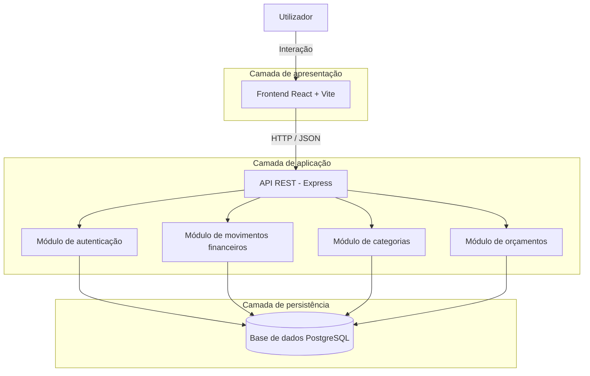

# ADR-001 — Adoção de uma arquitetura monolítica modular

- **Estado:** Aceite
- **Data:** 2026-10-14
- **Decisores:** Santiago Fernandes e João Estevão
- **Projeto:** FinTrack

## 1. Contexto

O FinTrack é uma aplicação web de gestão de despesas pessoais,
desenvolvida no âmbito da unidade curricular de Plataformas e
Serviços X-Ops.

A aplicação deverá permitir registar receitas e despesas,
organizar movimentos por categorias e consultar resumos financeiros.

O projeto será desenvolvido por uma equipa de dois elementos,
com implementação progressiva ao longo de cinco sprints.

A arquitetura deverá facilitar a manutenção, os testes automatizados,
a integração contínua, a segurança e a observabilidade.

## 2. Decisão

Adotar uma arquitetura monolítica modular, separando a aplicação
em três componentes principais:

- Frontend: React e Vite.
- Backend: Node.js e Express, através de uma API REST.
- Persistência: PostgreSQL.

O backend será organizado em módulos com responsabilidades
específicas, como movimentos financeiros, categorias e orçamentos.

A interface comunicará com o backend através de pedidos HTTP,
com dados transmitidos em formato JSON.

O backend será responsável pela validação dos pedidos,
pela lógica de negócio e pelo acesso à base de dados.

## 3. Alternativas consideradas

### Alternativa A — Arquitetura monolítica modular

Uma aplicação backend organizada em módulos, executada como
um único serviço.

**Vantagens:**
- Menor complexidade operacional.
- Facilidade de desenvolvimento e testes.
- Integração simples com pipelines CI/CD.
- Adequada a uma equipa pequena.

**Desvantagens:**
- O backend é publicado como uma unidade.
- O crescimento pode exigir uma reorganização dos módulos.

### Alternativa B — Arquitetura de microserviços

Dividir as funcionalidades em serviços independentes.

**Vantagens:**
- Possibilidade de publicar e escalar serviços individualmente.
- Maior independência entre equipas e componentes.

**Desvantagens:**
- Maior complexidade de comunicação e operação.
- Necessidade de gerir múltiplos serviços.
- Maior esforço de monitorização e diagnóstico.

### Alternativa C — Backend sem modularização explícita

Concentrar as rotas e a lógica de negócio numa estrutura simples,
sem separação clara de responsabilidades.

**Vantagens:**
- Arranque inicial rápido.

**Desvantagens:**
- Maior dificuldade de manutenção.
- Testes e alterações potencialmente mais difíceis.
- Menor clareza na separação das responsabilidades.

## 4. Consequências da decisão

A arquitetura monolítica modular permite manter o projeto simples,
sem abdicar da separação de responsabilidades.

A aplicação poderá ser testada através de testes unitários e
de integração.

A pipeline CI/CD poderá executar testes, análise estática de
segurança e outras verificações antes de permitir uma publicação.

A observabilidade poderá ser adicionada ao backend através de
métricas, registos e mecanismos de monitorização.

A escolha não impede uma futura divisão em serviços independentes,
caso existam necessidades concretas que justifiquem essa evolução.

## 5. Estado de implementação

A implementação será progressiva.

Na data deste registo, o backend possui uma configuração inicial
com Node.js e Express, um endpoint de verificação da API e um
teste automatizado aprovado.

O frontend e a persistência PostgreSQL ainda não estão implementados.

As restantes componentes serão desenvolvidas nos sprints seguintes.

## 6. Revisão

Esta decisão poderá ser revista se surgirem novos requisitos
funcionais, necessidades de escalabilidade ou limitações
arquiteturais demonstradas durante o desenvolvimento.

## Diagrama de arquitetura

