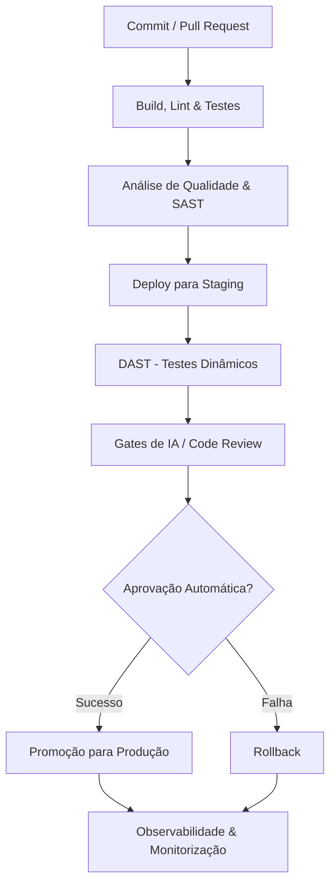

# Visão Geral do Pipeline CI/CD e Hub de Links

## 1. Diagrama do Pipeline CI/CD

O diagrama seguinte ilustra o fluxo contínuo de integração e entrega (CI/CD) planeado para o projeto FinTrack, cobrindo todo o processo desde a submissão de código até à monitorização em produção.

## 2. Fases de Implementação (Sprints)

O pipeline descrito acima não será implementado todo de uma vez, mas sim de forma incremental ao longo do projeto.

### Etapas do Sprint 1 (Atuais)
- **Commit / Pull Request:** Gestão de código via Git e GitHub.
- **Build, Lint & Testes:** Workflow no GitHub Actions (`ci.yml`) que garante a instalação de dependências, linting, compilação e execução de testes de forma automatizada e reproduzível.

### Etapas Futuras (Sprints 2 a 5)
- **Sprint 2:** Implementação do **Architectural Feedback Log (P1)**. Início do ciclo de feedback contínuo para validar se as decisões arquiteturais (como a arquitetura monolítica modular definida nos ADRs) se mantêm adequadas face à evolução do código.
- **Sprint 3:** Configuração e repetição dos **Gates (P2)**. Introdução de testes estáticos de segurança (**SAST**), testes dinâmicos em ambiente de staging (**DAST**) e validações de código assistidas por Inteligência Artificial (**Gates de IA**).
- **Sprint 4 e 5:** Estabelecimento de mecanismos de **Promoção/Rollback** contínuos para o ambiente de produção e introdução da **Observabilidade** (recolha de métricas, logs e monitorização do sistema).

## 3. Centralização de Links do Projeto

Este quadro serve como o ponto central para aceder a todos os recursos importantes e artefactos do projeto FinTrack:

| Recurso | Descrição | Link |
|---------|-----------|------|
| **Repositório** | Código-fonte no GitHub | [Link para o Repositório](https://github.com/teu-user/FinTrack) |
| **Execuções CI (Runs)** | Histórico do GitHub Actions | [Link para Actions](https://github.com/santiiago90/FinTrack/actions) |
| **Board do Jira** | Gestão de tarefas, Sprints e acompanhamento | [Link para o Jira ((https://santiagoadaofernandes.atlassian.net/jira/software/projects/XOPS/boards/34?filter=&groupBy=none)) |
| **Requisitos MVP** | Documento de requisitos funcionais | [mvp-requirements.md](./mvp-requirements.md) |
| **Arquitetura (Diagrama)**| Desenho da arquitetura base | [architecture.md](./architecture.md) |
| **ADR-001** | Decisão sobre a Arquitetura | [ADR-001-arquitetura-monolitica-modular.md](./ADR-001-arquitetura-monolitica-modular.md) |
| **CI/CD** | Configuração inicial e estratégia | [ci-cd.md](./ci-cd.md) |
| **Apresentações** | Slides das demonstrações e entregas | *(A adicionar futuramente)* |

---
*Nota: A estrutura deste documento visa assegurar a rastreabilidade arquitetural e processual, cumprindo os critérios P1 e P2 exigidos para o ciclo de desenvolvimento.*
