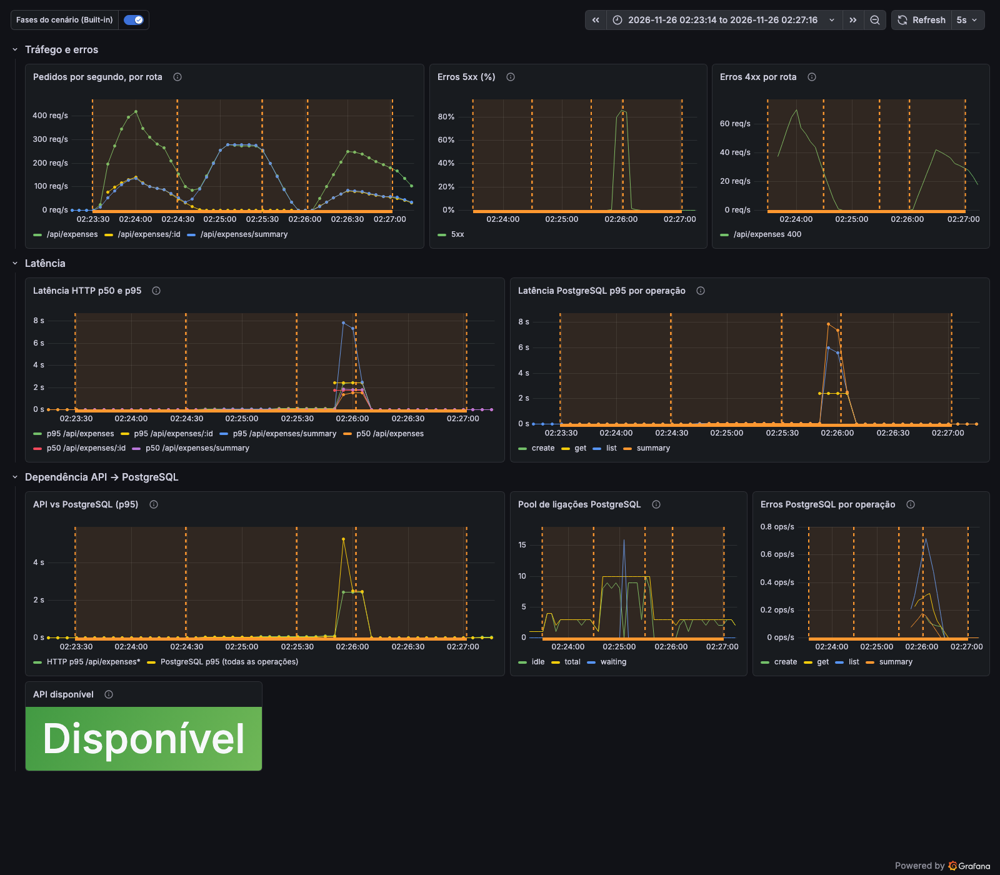
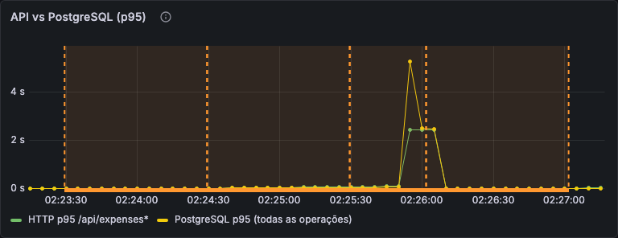

# XOPS-30 — Evidência do dashboard e do cenário controlado

[Sprint 4](README.md) · [Jira XOPS-30](https://santiagoadaofernandes.atlassian.net/browse/XOPS-30)

## Execução identificada

| Campo | Valor |
|---|---|
| Data | 26/11/2026, 02:23:29 → 02:27:01 UTC |
| Ambiente | Local, macOS (Apple Silicon), Docker Desktop, `compose.staging.yaml` com projeto `fintrack-staging` |
| Versão | `main` em `bcd6a98` mais as alterações da XOPS-30 (ainda não integradas) |
| Durações | seed 300 · `base` 60 s (2 clientes) · `rajada` 60 s (60 clientes) · `db-indisponivel` 32 s (2 clientes, `docker compose pause db`) · `recuperacao` 60 s (2 clientes) |
| Dados | [Resumo e linha temporal](xops-30-scenario-summary.json) (cópia de `artifacts/observability/scenario-summary.json`) |

## Resultado por fase

Há duas fontes de números.

**Medido na API (Prometheus).** Resultado de `scenario-summary.md`. Cada linha mede só a sua fase, com uma consulta instantânea no fim da fase sobre a duração da fase.

| Fase | Pedidos/s | 5xx % | p95 HTTP (ms) | p95 DB (ms) | Pool à espera (máx) | Erros DB (total) |
|---|---|---|---|---|---|---|
| base | 475,7 | 0¹ | 5,0 | 4,5 | 0 | 0¹ |
| rajada | 513,6 | 0¹ | 69,0 | 45,2 | 16 | 0¹ |
| db-indisponivel | 1,2 | 83,8 | 2427,8 | 2484,0 | 0 | 35 |
| recuperacao | 343,8 | 0,0 | 10,0 | 8,7 | 0 | 0 |

¹ O relatório desta execução mostrou "—": sem nenhum erro, o Prometheus não tem série. A versão atual do relatório devolve 0 nestes casos.

**Medido no cliente (`scenario-timeline.json`).** Pedidos feitos pelo cenário através do nginx.

| Fase | Pedidos/s no cliente | Respostas 502 (nginx) | Respostas 500 (API) | Falhas vistas pelo cliente |
|---|---|---|---|---|
| base | 594,6 | 7767 (21,8 %) | 0 | 21,8 % |
| rajada | 719,8 | 14 999 (34,7 %) | 0 | 34,7 % |
| db-indisponivel | 66,1 | 2092 (98,4 %) | 27 | 99,7 % |
| recuperacao | 351,4 | 0 | 0 | 0 % |

As consultas PromQL exatas de cada número e de cada painel estão em `scenario-queries.json`, no artefacto da execução.

## Capturas

Dashboard completo na janela do cenário. As linhas tracejadas laranja marcam o início e o fim de cada fase:

Vista arquitetural **API vs PostgreSQL (p95)**:

## Interpretação das curvas

### 1. Base: a latência da API é a latência da base de dados
Com 2 clientes em ciclo contínuo, a API respondeu a ~476 pedidos/s:
- p95 HTTP de 5,0 ms e p95 PostgreSQL de 4,5 ms;
- o pool nunca teve pedidos à espera.

Cerca de 90% do tempo de cada pedido é gasto no PostgreSQL. O Express acrescenta menos de 1 ms. Na vista "API vs PostgreSQL", as duas curvas estão sobrepostas.

### 2. Rajada: o gargalo é o pool de 10 ligações
Com 60 clientes, o débito da API subiu só 8% (476 → 514 pedidos/s), mas a latência subiu 14 vezes:
- o p95 HTTP passou de 5 para 69 ms e o p95 DB de 4,5 para 45 ms;
- no painel "Pool de ligações", `total` ficou colado em 10 (o máximo do `pg.Pool`), `idle` caiu para 0 e `waiting` chegou a 16 pedidos à espera.

A capacidade do sistema está limitada pelas 10 ligações ao PostgreSQL. A carga extra não aumenta o débito: transforma-se em fila de espera e, por isso, em latência. Como o p95 DB inclui a espera por uma ligação, as duas curvas sobem juntas.

### 3. Base de dados indisponível: a falha é contida pelos timeouts
Com o PostgreSQL congelado durante 32 s:
- a API devolveu 5xx em 84% dos pedidos que lhe chegaram, e os erros DB subiram em todas as operações;
- o p95 HTTP ficou em ~2,4 s, que corresponde ao `DB_CONNECTION_TIMEOUT_MS` de 2 s;
- o resumo mensal, que já tinha uma query em curso, chegou a ~8 s no p95 por rota, ou seja, o `DB_QUERY_TIMEOUT_MS` de 5 s mais a espera da ligação.

A API manteve-se **disponível** (`up` = 1) e não terminou. Antes da correção em `backend/src/db.js`, o processo terminava com o erro do pool, ou os pedidos ficavam pendurados sem limite.

### 4. Recuperação: imediata, mas a latência não voltou à base
Depois do `unpause`, os 5xx voltaram a 0 em menos de 10 s, sem reiniciar nada, e o pool repôs as ligações sozinho. Mesmo assim:
- o p95 HTTP ficou em 10 ms, o dobro da base;
- o p95 de `/api/expenses` subiu ao longo da fase, de 10 para 20 ms.

O cenário criou ~7500 despesas, e `GET /api/expenses?month=…` devolve o mês inteiro sem paginação. A latência da listagem cresce com o volume de dados, uma limitação já conhecida do MVP que o dashboard agora quantifica.

## Conclusão arquitetural

1. **Dependência e gargalo confirmados.** A latência da API é dominada pelo PostgreSQL, e a capacidade está limitada pelo pool de 10 ligações (~500 pedidos/s neste Mac). Aumentar o tráfego sem aumentar o pool, ou sem otimizar as queries, só aumenta a fila.

2. **Ponto cego da observabilidade.** O dashboard mostrou 0% de 5xx nas fases `base` e `rajada`, mas o cliente recebeu **502 do nginx em 22% e 35% dos pedidos**. Esses pedidos nunca chegaram à API: em cada fase, os pedidos do cliente menos os 502 correspondem aos pedidos que a API contou. Medir só na API esconde as falhas da camada de proxy.
   - **Confirmado: foi o nginx que respondeu os 502.** O registo de acessos do nginx tem 24 867 respostas 502, quase exatamente as 24 858 recebidas pelo cliente.
   - **Causa: por apurar na XOPS-34.** O nginx não registou nenhuma linha `[error]` (só avisos de respostas grandes escritas em ficheiros temporários), o que exclui a primeira hipótese, o esgotamento de portas efémeras. Fica por ver a configuração do `error_log` do nginx e a interação entre o `proxy_pass` sem `keepalive` e as ligações do Node.
   - A fase `recuperacao`, abaixo de ~350 pedidos/s, não teve nenhum 502.
3. **Melhorias propostas para o Architectural Feedback Log (XOPS-34):**
   - medir também no nginx (logs de acesso ou exporter) ou com uma sonda externa, para que os 502 apareçam no dashboard;
   - paginação na listagem de despesas: o nginx já escreve algumas respostas de `GET /api/expenses?month=…` em ficheiros temporários por serem maiores do que os buffers;
   - rever o tamanho do pool (`max`) face ao limite de ligações do PostgreSQL.

Observação já registada durante a preparação: sem tratamento de erros nem timeouts no `pg.Pool`, uma falha do PostgreSQL terminava o processo da API ou deixava pedidos pendurados. A correção está em `backend/src/db.js` e foi validada pela fase 3.

## Reproduzir

Ver [Dashboard e cenário controlado](README.md#dashboard-e-cenário-controlado-xops-30).
